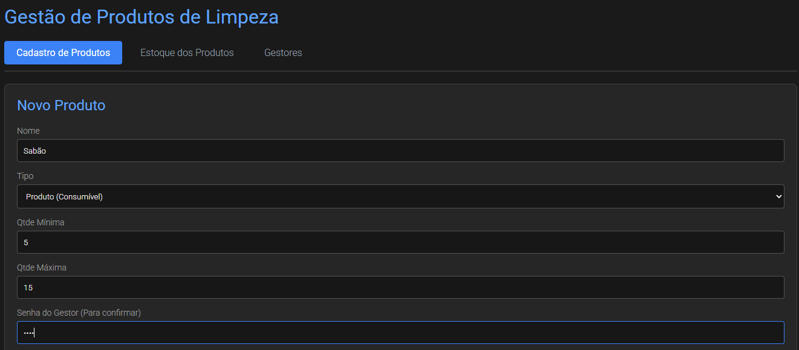
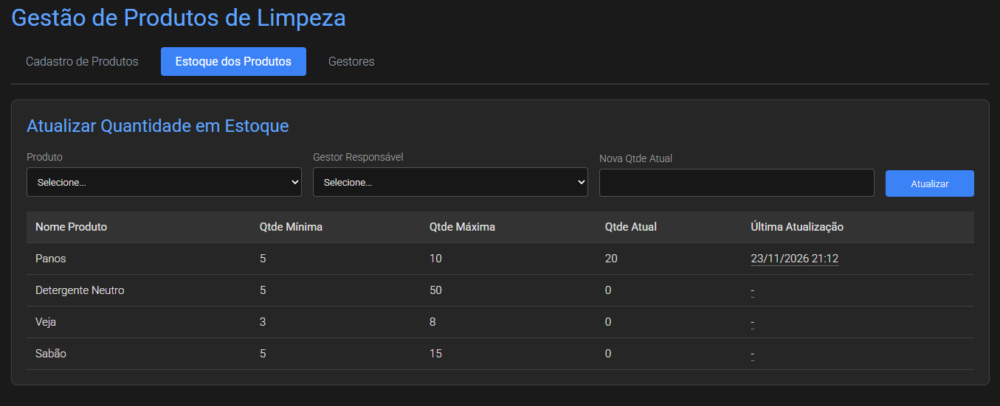
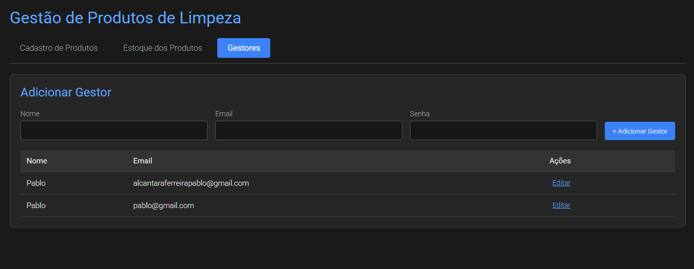
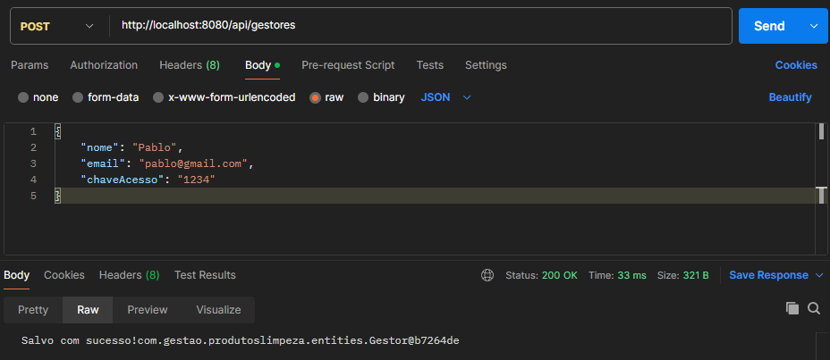
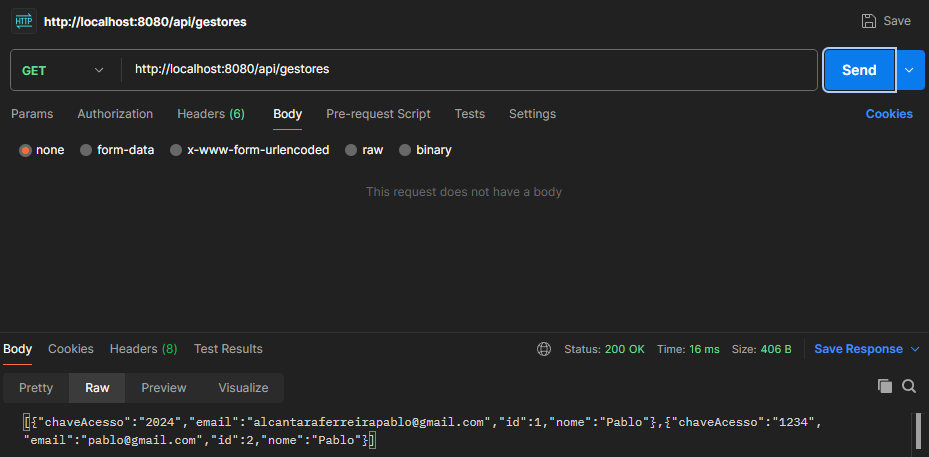
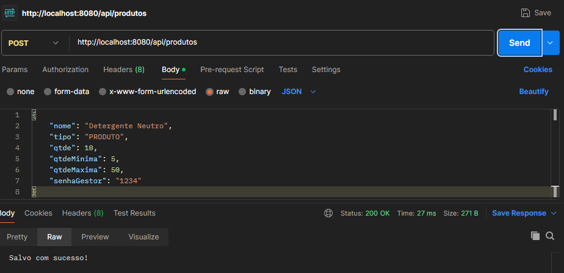
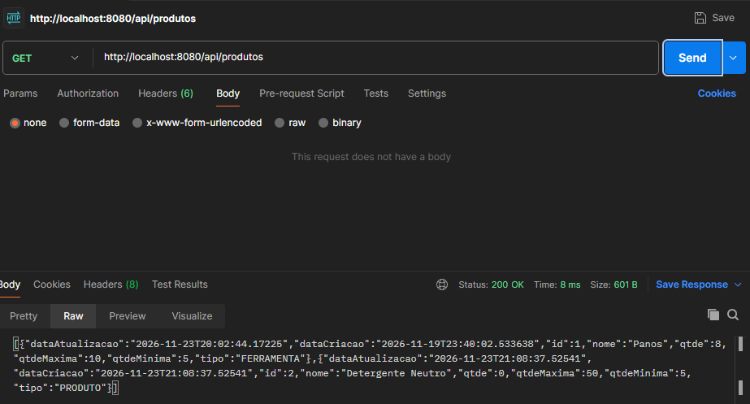
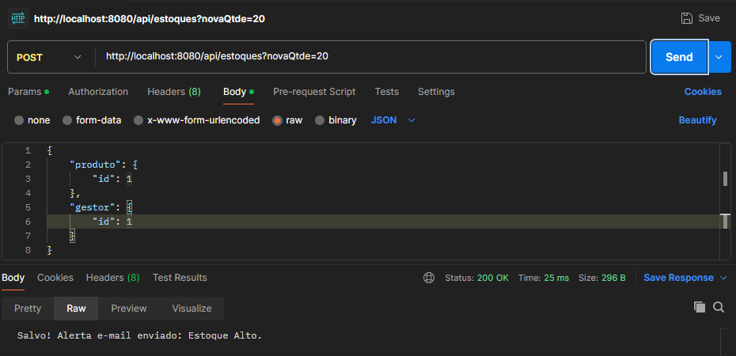
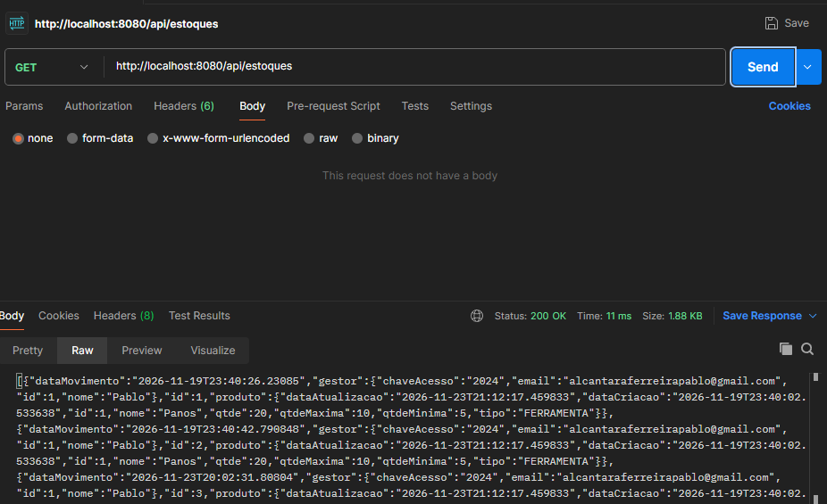

# 🧹 Sistema de Gestão de Produtos de Limpeza

Aplicação web Full-Stack desenvolvida para o gerenciamento de produtos de limpeza, ferramentas, gestores e controle de movimentações de estoque. O sistema conta com uma API REST construída em Java com Spring Boot e uma interface limpa e responsiva em HTML, CSS e JavaScript puro.

## ✨ Funcionalidades

* **📦 Cadastro de Produtos:**
  * Registro de itens com categorização pré-definida via `Enum` (`PRODUTO` ou `FERRAMENTA`).
  * Definição de quantidade mínima e máxima permitida em estoque.
  * **Segurança:** Validação obrigatória da chave de acesso de um gestor cadastrado para autorizar novos cadastros.
  * Registro automático de data de criação e última atualização.

* **📊 Controle de Estoque:**
  * Visualização em tabela com os limites (mínimo e máximo) e a quantidade atual de cada item.
  * Atualização de saldo vinculando o produto ao gestor responsável pela movimentação.
  * **Histórico com Tooltip:** Ao passar o mouse sobre a data da última atualização, o sistema exibe quem realizou a alteração e o horário exato.
  * **Alertas de Limite:** Notificação automática na interface (e log no console do servidor) sempre que a quantidade atual ficar abaixo do mínimo ou acima do máximo estipulado.

* **👤 Gestão de Gestores:**
  * Cadastro e listagem de gestores com nome, e-mail e chave de acesso (senha).

---

## 🖥️ Interface do Sistema (Front-End)

### 1. Cadastro de Produtos


Tela responsável pelo registro de novos itens no catálogo. Nela, o usuário informa o **Nome**, seleciona o **Tipo** (travado via `Enum` entre *Produto Consumível* ou *Ferramenta/Equipamento*), define as quantidades **Mínima** e **Máxima** e insere a **Senha do Gestor** para validar e autorizar o cadastro no Back-End.

### 2. Estoque dos Produtos


Painel principal de acompanhamento de saldo. Na parte superior, é possível selecionar um produto, indicar o gestor responsável e atualizar a quantidade atual. A tabela abaixo exibe todos os produtos cadastrados com seus respectivos limites e saldo atual. Na coluna **Última Atualização**, a data sublinhada (como no item *Panos*) indica que há um histórico registrado — ao passar o mouse por cima, um *tooltip* revela o nome do gestor e o momento exato da alteração.

### 3. Gestão de Gestores


Aba dedicada ao gerenciamento dos responsáveis pelo sistema. Permite cadastrar novos gestores informando **Nome**, **Email** e **Senha (Chave de Acesso)**, além de listar em tabela todos os gestores ativos no banco de dados.

---

## 🧪 Testes da API no Postman (Back-End)

Todas as rotas da API REST foram validadas utilizando o Postman:

### 1. Cadastrar Gestor (`POST /api/gestores`)


Envio de um objeto JSON contendo `nome`, `email` e `chaveAcesso` para criar um novo gestor no banco de dados. A API retorna status **`200 OK`** com a confirmação `"Salvo com sucesso!"`.

### 2. Listar Gestores (`GET /api/gestores`)


Consulta que retorna um array JSON com todos os gestores cadastrados no MySQL, exibindo seus respectivos IDs, nomes, e-mails e chaves de acesso.

### 3. Cadastrar Produto (`POST /api/produtos`)


Requisição para criação de um novo produto (*Detergente Neutro*). Além dos dados do item, o corpo JSON envia o campo `senhaGestor`, que é validado pelo `ProdutoController` antes de permitir a gravação no banco. Com a senha correta, retorna **`200 OK`** e `"Salvo com sucesso!"`.

### 4. Listar Produtos (`GET /api/produtos`)


Retorna a lista completa de produtos cadastrados. É possível observar o preenchimento automático dos campos `dataCriacao` e `dataAtualizacao` (via Hibernate), o tipo mapeado como texto (`FERRAMENTA` / `PRODUTO`) e o fato de novos produtos iniciarem com `qtde: 0` até receberem uma movimentação de estoque.

### 5. Atualizar Estoque e Regra de Alerta (`POST /api/estoques?novaQtde=20`)


Movimentação de estoque vinculando o `produto` (ID `1` - *Panos*) e o `gestor` (ID `1`), passando a nova quantidade via parâmetro na URL (`novaQtde=20`). Como a quantidade máxima configurada para *Panos* é `10`, a regra de negócio detecta o excesso e retorna o aviso: **`"Salvo! Alerta e-mail enviado: Estoque Alto."`**

### 6. Histórico de Movimentações (`GET /api/estoques`)


Consulta que lista todo o histórico de alterações realizadas no estoque. Cada registro traz a data e hora exatas (`dataMovimento`) junto com os objetos completos do `gestor` responsável e do `produto` atualizado.

---

## 🛠️ Tecnologias Utilizadas

**Back-End:**
* Java
* Spring Boot (Web & Data JPA)
* MySQL
* Maven

**Front-End:**
* HTML5
* CSS3 
* JavaScript

## 🔗 Endpoints da API

| Recurso | Método | Rota | Descrição |
| ----- | ----- | ----- | ----- |
| **Produtos** | `GET` | `/api/produtos` | Lista todos os produtos cadastrados |
| **Produtos** | `POST` | `/api/produtos` | Cadastra um novo produto (exige `senhaGestor` válida) |
| **Produtos** | `PUT` | `/api/produtos/{id}` | Atualiza os dados de um produto |
| **Produtos** | `DELETE` | `/api/produtos/{id}` | Remove um produto |
| **Estoques** | `GET` | `/api/estoques` | Lista o histórico de movimentações de estoque |
| **Estoques** | `POST` | `/api/estoques?novaQtde={valor}` | Atualiza a quantidade do produto e registra a movimentação |
| **Gestores** | `GET` | `/api/gestores` | Lista todos os gestores cadastrados |
| **Gestores** | `POST` | `/api/gestores` | Cadastra um novo gestor |

## 🚀 Como Executar o Projeto - passo a passo


1. **Clone o repositório:**
   ```bash
   git clone https://github.com/seu-usuario/produtosLimpeza.git
   ```

2. **Crie o banco de dados no MySQL:**
   ```sql
   CREATE DATABASE gestao;
   ```

3. **Execute o Back-End:**
   Rode a classe principal `ProdutosLimpezaApplication.java` pela sua IDE. O servidor será iniciado na porta `8080`.

4. **Acesse o Front-End:**
   Abra o navegador e acesse `http://localhost:8080` (ou abra o arquivo `index.html` diretamente no navegador).

## 🔮 Melhorias Futuras

* [ ] Implementação de tela de login dedicada para acesso ao sistema.
* [ ] Envio real de alertas por e-mail via `Spring Mail` (SMTP) quando o estoque sair dos limites.
* [ ] Funcionalidades completas de edição e exclusão diretamente pelas tabelas no Front-End.
